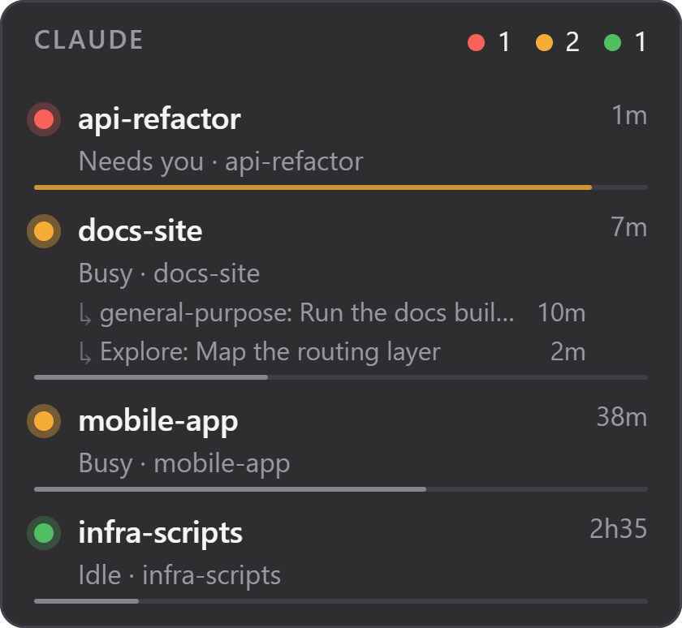

# Claude Session Widget

A small always-on-top widget that shows your running [Claude Code](https://claude.com/claude-code) sessions: which ones are working, which are idle, and which are waiting for you.



- One row per live session: name, project folder, state, time spent in that state.
- Sessions that need you come first. The tray icon takes the colour of the most urgent one.
- The tray icon is the app icon with a dot in the colour of the most urgent state. Its menu covers show/hide, always on top, compact mode, opacity and start at login.
- Double-click a session to bring its terminal or editor window to the front (the project folder opens if no window is found).
- Placement: lock the position, exact position in pixels (nudge buttons), click-through.
- Optional usage quotas: 5-hour and weekly bars, with the reset time once a window is nearly used up, and a context bar per session.
- Optional agents and background tasks: the running ones are listed under their session.
- Optional notifications when a session needs you, finishes, or a quota is nearly used up.
- Optional layout helpers: fold sessions idle for an hour, collapse to the header while nothing runs, and a global show/hide shortcut.
- Reads the session files Claude Code already writes, and makes no network access. Only the two options above touch your Claude Code setup, and only if you turn them on (see [Optional features](#optional-features)).
- Windows, macOS and Linux (see [platform status](#platform-status)).

Unofficial project, not affiliated with Anthropic.

| Dot | State |
| --- | --- |
| Red | Needs you (waiting for input or a permission) |
| Orange | Busy |
| Green | Idle |
| Grey | Unknown status |

## Install

### From a release

Download the archive for your platform from the Releases page, extract it and run `ClaudeSessionWidget`. Enable **Start at login** in the tray menu if you want it to launch with your session.

The binaries are not code-signed:

- Windows: SmartScreen may warn on first launch; choose "More info", then "Run anyway".
- macOS: remove the quarantine flag once with `xattr -d com.apple.quarantine ClaudeSessionWidget`.

Release archives come with `SHA256SUMS.txt`.

### From source

Requires [Rust](https://rustup.rs) (stable) and the platform dependencies of [Tauri](https://tauri.app/start/prerequisites/): the Visual Studio C++ Build Tools on Windows (WebView2 ships with Windows 11), WebKitGTK and libayatana-appindicator on Linux, the Xcode command line tools on macOS.

```sh
git clone <repository-url>
cd claude-session-widget
scripts/install.sh                                                          # Linux, macOS
powershell -NoProfile -ExecutionPolicy Bypass -File scripts\install.ps1     # Windows
```

The first build compiles all dependencies and takes several minutes. The new build is staged first, so a failed build leaves the previous installation untouched.

| | Windows | Linux / macOS |
| --- | --- | --- |
| Installed to | `%LOCALAPPDATA%\ClaudeSessionWidget\app` | `~/.local/share/ClaudeSessionWidget/app` (Linux), `~/Library/Application Support/ClaudeSessionWidget/app` (macOS) |
| Launcher | Start Menu shortcut | Desktop entry (Linux only) |

Options: `-InstallDir`, `-StartMenuDir`, `-Autostart`, `-Quotas`, `-Agents`, `-NoLaunch` on Windows; `--install-dir`, `--quotas`, `--agents`, `--no-launch` on Linux and macOS (use the tray menu for start at login there).

**Update** with `scripts/update.sh` or `scripts\update.ps1`: it runs `git pull --ff-only`, then reinstalls. Settings and the start-at-login choice are kept.

**Uninstall** with `scripts/uninstall.sh` or `scripts\uninstall.ps1`. It stops the widget and removes the installed files, launcher and autostart entry. Settings are kept unless you pass `--purge` (`-Purge` on Windows). Nothing is deleted if the install folder does not hold an installation.

## Usage

- Drag the widget to move it; the position is remembered.
- Left-click the tray icon to show or hide it.
- Right-click the widget or the tray icon for the menu.

Only one instance runs at a time.

Double-clicking a session looks for the window of the terminal or editor that started it, and prefers the one whose title mentions the project. On Linux and macOS, and when no window is found, it opens the project folder instead.

Layout options in the tray menu:

- **Fold sessions idle for an hour** replaces them with a single "+N idle" line.
- **Collapse when nothing is running** shrinks the widget to its header while no session is busy or waiting; hovering it expands it again.
- **Show/hide shortcut** registers a global shortcut (Ctrl+Alt+C, Ctrl+Alt+W or Ctrl+Alt+Space; Cmd on macOS). If another application already owns it, the widget says so.

Placement options in the tray menu:

- **Lock position** disables dragging.
- **Click-through** lets mouse clicks pass through the widget to the window below. The widget then cannot be right-clicked: use the tray icon to change settings or turn it off again.
- **Position** shows the current coordinates and moves the widget by 1 or 10 screen pixels in any direction. The position is saved after every move; **Reset position** returns to the top-right corner.

## Optional features

Both are off by default. Enable them from the tray menu or at install time.

- **Show usage quotas and context** (`-Quotas` / `--quotas`) adds two thin bars for the 5-hour and weekly limits. When a window reaches 90 %, a line under the bars says when it resets. It also draws a thin context bar at the bottom of each session (orange from 80 %, red from 95 %); hovering a session shows its model, context and cost.
- **Show agents and background tasks** (`-Agents` / `--agents`) lists the running subagents and background tasks under their session (up to three lines, the rest folded into "+N more"). In compact mode a small counter replaces the lines.

Claude Code only hands this data to commands configured in its settings, so enabling an option registers the widget itself in `~/.claude/settings.json` (or `$CLAUDE_CONFIG_DIR/settings.json`): `ClaudeSessionWidget --statusline` as the `statusLine` for quotas, `ClaudeSessionWidget --subagent-status` as the `subagentStatusLine` for agents. These commands print nothing and write what they receive to the data folder; the widget makes no network request. Notes:

- An existing `statusLine` or `subagentStatusLine` is never replaced. If you already have one, the option is refused and the widget says so.
- Turning an option off, and uninstalling, remove the entry again. The other settings in the file are left as they are.
- The `statusLine` command is known to run in terminal sessions; the VS Code extension and the desktop app may not run it. Quotas therefore have three sources, the newest one winning for each window: the status line, the usage Claude Code last cached in `~/.claude.json`, and any limit Claude Code reported as exceeded in a recent transcript (shown as fully used, with its reset time). Figures older than 15 minutes carry an "usage as of HH:MM" line, and windows that have already reset are dropped. The cache is only refreshed now and then, so without a terminal session the bars can lag behind.
- Agent lines disappear after 30 seconds without an update. Nothing is shown if Claude Code reports no limits for your account.
- Which kinds of background work appear in the agent list depends on what Claude Code puts in its agent panel; the widget shows every running entry it receives.

**Notifications** (tray menu only) can be switched on separately for a session that needs you, a session that finishes (busy to idle), and a quota reaching 90 % (once per reset period; it needs the usage option above). They are system notifications and never replay what was already true when you turn them on. Whether "needs you" ever fires depends on the status values Claude Code writes, of which only `busy` and `idle` have been observed.

## Configuration

Everything is set from the menu and stored in `settings.json` in the data folder:

| Platform | Data folder |
| --- | --- |
| Windows | `%APPDATA%\ClaudeSessionWidget` |
| Linux | `~/.config/ClaudeSessionWidget` |
| macOS | `~/Library/Application Support/ClaudeSessionWidget` |

Environment variables override locations, mostly for tests: `CLAUDE_WIDGET_SESSIONS_DIR` (default `~/.claude/sessions`), `CLAUDE_WIDGET_DATA_DIR`, and `CLAUDE_CONFIG_DIR` (the Claude Code configuration folder, default `~/.claude`).

## How it works

Claude Code writes one JSON file per live session (pid, name, working directory, status, timestamps) to `~/.claude/sessions`. The Rust backend reads that folder every second and sends the result to the page.

A session file can outlive a crashed process, so a session is only listed if its pid is alive. On Windows its process start time must also match the file, which rules out recycled pids.

Status mapping: `busy` and `idle` are known values; a status containing `wait`, `input`, `permission` or `approval` means the session needs you; anything else is shown as unknown. Only `busy` and `idle` have been observed so far, so the "needs you" detection is a best guess.

## Development

```sh
cargo test --manifest-path src-tauri/Cargo.toml      # backend
node --test tests/format.test.mjs                    # UI formatting
tests/scripts.tests.sh                               # Linux/macOS installer scripts
```

Windows-only tests, after `cargo build --release --manifest-path src-tauri/Cargo.toml`:

```powershell
powershell -NoProfile -File tests\e2e.ps1            # drives the real exe
powershell -NoProfile -File tests\scripts.tests.ps1  # installer scripts (rebuilds, takes a few minutes)
```

The end-to-end test needs no mouse and no focus: it runs the executable against a fake sessions folder with its own settings and WebView2 profile, reads the page through the WebView2 DevTools protocol, and runs menu entries through the app's `menu_action` command.

```
src/         UI (HTML, CSS, JS, no build step)
src-tauri/   Rust backend: sessions, settings, tray, menu, window
tests/       UI tests, Windows end-to-end test, installer script tests
scripts/     install, update, uninstall (PowerShell and shell)
```

CI runs formatting, clippy and the tests on all three platforms, plus the shell installer test on Linux. Pushing a `v*` tag builds the binaries and publishes a release; the tag must match the version in `src-tauri/Cargo.toml`.

## License

[MIT](LICENSE)

## Platform status

| Platform | Status |
| --- | --- |
| Windows 10/11 | Developed and tested, including the end-to-end and installer tests |
| Linux | Built and unit-tested in CI; never run by hand |
| macOS | Built and unit-tested in CI; never run by hand |

Known limits on Linux and macOS:

- Wayland compositors may ignore "always on top" for normal windows; X11 works.
- GNOME needs an AppIndicator extension to show tray icons.
- On macOS the widget is a bare binary, not an app bundle, and lives in the menu bar.
